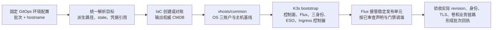

# PROD-K3S-V6 独立节点、集群冷启动规划与部署状态归档

## 本轮执行与阻断更新（2026-10-31 17:20 Asia/Shanghai）

本节优先于下文较早的状态快照。核对来源为 GitHub Actions 与对应 owner PR；本轮没有重新 SSH 登录节点，也没有执行节点初始化、K3s/Flux、服务部署、数据迁移或 DNS 操作。

| 阶段 | 当前状态 | 证据与结论 |
| --- | --- | --- |
| IaC/CMDB | ✅ 最近一次 owner 回执通过，资源无变化 | [完整流水线 41187083044](https://github.com/ai-workspace-infra/Platform-Orchestrator/actions/runs/41187083044) 的 IaC 子运行 [41187178349](https://github.com/ai-workspace-infra/Platform-Orchestrator/actions/runs/41187178349) 返回 `applied_verified`，create/update/delete 均为 0；回执含 1 个 K3s 目标及 100 GB 数据卷 CMDB。此结果只说明云资源收敛，不表示数据盘已有文件系统或已挂载。基础仓库解析 SHA：Orchestrator `97810aa8f2818c3b9c44c70ee5e2ebc575981d71`、IaC `7539663f9eb63d86466179d538578146922ed476`、GitOps `2179623e932df7d5083ff6c8c8b9b1baed64dcc2`。 |
| 主机初始化 | ❌ 未运行 | 同次流水线 `[2/5] Provision` 在访问 legacy Vault role `github-actions-platform-ops-toolkit-prod` 时因 JWT `ref` 不匹配而失败，未进入 Playbooks common；K3s bootstrap 与后续阶段均跳过。运行参数为 `dns_mode=none`，没有 V5/canonical DNS 操作。 |
| Orchestrator 调用修复 | ❌ PR 待合并 | [Orchestrator #1585](https://github.com/ai-workspace-infra/Platform-Orchestrator/pull/1585) 已通过检查但仍为 OPEN。修复目标是 K3s 走 CMDB catalog → GitOps 节点声明交接，并跳过传统 Web SaaS 主机的 Vault 凭据预处理。 |
| 公共 Vault bootstrap reader | ❌ 声明与调用待合并/应用 | [GitOps #684](https://github.com/ai-workspace-infra/gitops/pull/684) 与 [Playbooks #920](https://github.com/ai-workspace-infra/playbooks/pull/920) 检查已通过但仍为 OPEN。GitOps 声明 V6 精确只读 SSH/OS 公钥记录；Playbooks common 以 HTTPS API 消费 Vault token，不依赖 runner 安装 Vault CLI。受控管理员尚未应用该 reader role，真实 JWT allow/deny 未验收。 |
| ESO、PostgreSQL 与应用密钥 | ❌ 仍有配置缺口 | [GitOps #685](https://github.com/ai-workspace-infra/gitops/pull/685) 头提交 `c96fa526f6cd610eec6113109673229a1d8ce099` 的检查已通过但 PR 仍为 Draft；Gitleaks 误报已按精确 commit/path/rule/line 豁免。该候选暂不启用 PostgreSQL exporter，且 Accounts/Billing 数据库运行凭据与实际数据库角色尚未形成完整同步/授权链；不得用 admin 凭据替代。 |
| PostgreSQL exporter 制品 | ❌ PR 与 release 未完成 | [Artifacts #253](https://github.com/ai-workspace-infra/artifacts/pull/253) 要求 exporter 使用独立用户名与 Secret，禁止回退到 admin/auditor；chart 计划升级到 umbrella `0.2.14` / PostgreSQL subchart `0.1.7`。本机 `.github/scripts/check-web-saas-charts.sh` 通过，GitHub chart 检查当时仍在运行；尚未合并、发布或固定到 GitOps。 |
| Flux 与服务验收 | ❌ 未开始 | 本轮主线在 Vault 预处理处失败，Flux 接管、Vault 初始化/手动 unseal、PostgreSQL、Observability、Web SaaS、Ingress 及运行/业务验收均无新回执。 |

**下一步顺序**：等待 #1585、#684、#920 合并；对照合并后的 GitOps `main` 受控应用 V6 bootstrap reader role/policy；确认 #685 的应用 DB 凭据合同和 exporter 身份方案，并在 Artifacts chart PR 发布后更新 digest；随后用最新主线 SHA 重跑完整 `deploy`。common 通过 hostname、三账户、主机基线和独立盘 UUID/挂载验收之前，不放行 K3s bootstrap。

## 当前状态补充（2026-10-31）

以下记录覆盖下文与当前节点冲突的历史状态；历史回执不代表当前节点验收通过。

| 项目 | 状态与证据 |
| --- | --- |
| 节点与盘 | ❌ 只读 SSH 核验：hostname 为 `prod-k3s-v6`，100 GB `sdc` 无文件系统、无挂载点；K3s 服务未运行。盘初始化与挂载尚未执行验收。候选已将云盘长标签与 ext4 文件系统标签分开，避免超过 16 字节的校验失败。 |
| common | ❌ 当前节点尚无包含独立盘和完整安全基线的就绪回执。[Playbooks #916](https://github.com/ai-workspace-infra/playbooks/pull/916) 已将独立盘挂载与 UUID 纳入 K3s 主线 common 回执条件。 |
| 调用链 | ❌ [Orchestrator #1583](https://github.com/ai-workspace-infra/Platform-Orchestrator/pull/1583) 为草稿候选；候选按 CMDB `deployment_mode` 区分 Kubernetes 与传统 Web SaaS 主机，避免 K3s 进入传统主机部署和凭据初始化；CMDB、GitOps 声明及 K3s owner 交接尚无完整运行回执。 |
| 三身份与 Vault writer | ❌ [Playbooks #918](https://github.com/ai-workspace-infra/playbooks/pull/918) 和 [GitOps #683](https://github.com/ai-workspace-infra/gitops/pull/683) 已合并。已使用 GitOps `2179623e932df7d5083ff6c8c8b9b1baed64dcc2` 定向应用专用 writer policy/role；只读核验确认 3 条精确路径的 create/read 策略及受保护 PROD Deploy 工作流绑定。真实 JWT 登录、相邻路径拒绝、节点签发及 RBAC 验收仍未执行。 |
| 服务凭据来源 | ❌ 只读检查证实 PostgreSQL 三个角色记录及 `kv/prod/accounts/runtime` 存在；仅核验记录及字段名，并非连接验收。两个 OAuth 路径未能确认。PostgreSQL `postgresql-superuser` 和 Web SaaS 引用的运行 Secret 尚无对应 V6 ESO 生成声明，不能认定服务可启动。 |
| Flux、服务及 DNS | ❌ 尚无当前节点 Flux 接管、Vault、数据库、监控、Web SaaS 或 Ingress 实际验收；候选新增独立身份和 Flux 对象就绪回执，各 source/unit revision 分开记录，但接口、数据和用户流程仍需单独验收。V5 与 canonical DNS 保持不变。 |

> 归档日期：2026-10-30（北京时间，UTC+08:00）。
>
> ✅ 本轮规划和状态记录已归档。❌ V6 全量服务部署、数据与业务验收尚未完成。
>
> 本文整理用户提供的最新规划文本和此前核对的运行回执，是截至所列证据时间的记录，**不是实时集群巡检报告**。最近一份部署门禁回执更新于 **2026-10-30 08:53:56**。本文件最初归档时只新增 Markdown，不创建云资源、不部署、不迁移数据、不修改 DNS；后续各节按增量记录更新。

> **2026-10-30 增量修订**：第 12 节保留后续 OS 验收历史；第 13 节收敛通用命名与幂等执行设计。用户最新说明原 `prod-k3s-v6` 节点已删除，尚未在本轮核验云平台、遗留卷和 state；历史 ✅ 不作为新建节点的验收证据。新规划的根 Kustomization 名为 `prod-k3s`，目录仍按 `prod-k3s-v6` 批次隔离，实际声明和执行器尚待同步改造。

> **2026-10-30 域名规划补充**：用户提供 V5 域名状态作为对照并确认 V6 批次名称。V6 建议名称的 Google DoH A 只读查询结果为 NXDOMAIN。用户明确要求 V6 专属域名最终解析生效；执行前仍需 V6 实际节点地址。`dns_mode=none` 用于禁止工作流默认改写 canonical 名称，不阻止 DNS owner 仅为 V6 批次新增专属记录。V5/canonical DNS 不改。V5 状态仍标注为用户提供的历史/待补证据，不能当作本轮在线验收。

## 1. 状态标记与目标

| 标记 | 含义 |
| --- | --- |
| ✅ 完成 | 已有明确证据支持该项完成；如果只验证了历史引导，在说明中限定其时间和范围 |
| ❌ 未完成 | 尚未执行、缺少验收证据、存在阻断或当前状态待核实；不等于已证明资源不存在 |

**V6 的目标**：在独立节点、独立集群和独立存储上完成全部服务冷启动与验收，形成可供后续数据迁移和切换评审的候选环境。

- V5/canonical DNS 保持不变；V6 专属域名在新节点地址确认后新增解析，不指向 V5 节点。`dns_mode=none` 禁止 canonical 默认更新，V6 专属记录由受控 DNS owner 单独处理。
- 保留 V5 集群、数据库及原业务写入方。
- 新节点创建、全量服务部署、业务验收和流量/写入权切换分别判定，不相互替代。
- 当前工作为规划和状态整理；数据迁移、切换及旧环境退役另按具体任务授权执行。

## 2. 规划基线与工作树

| 项目 | 状态 | 核对结果 |
| --- | --- | --- |
| [GitOps PR #648](https://github.com/ai-workspace-infra/gitops/pull/648) | ✅ 已合并 | V6 独立资源规划起点；原分支 `feature/prod-k3s-v6-plan` |
| 原工作树 `/tmp/gitops-prod-k3s-v6` | ✅ 已核对 | 存在，核对时工作树干净 |
| 原工作树当前分支 | ✅ 已核对 | `feature/prod-k3s-v6-execution-handoff`，已不是最初的规划分支 |
| 后续 GitOps 规划 | ✅ 已形成声明 | 已增加 ESO、TLS 身份和 TLS 同步前置层，并去掉服务名的 `platform-` 前缀；不代表这些对象均已运行验收 |
| [GitOps PR #671](https://github.com/ai-workspace-infra/gitops/pull/671) | ✅ 已合并 | 合并提交 `6b70c229c7999a273da6067d17ff20be8e7d4eae`，补充部署与升级门禁说明 |
| V6 历史引导记录 | ✅ 有证据 | 节点、独立盘和 K3s/Flux 引导通过；完整运行状态仍需刷新 |
| V5 实时身份 | ❌ 未核实 | 本轮未连接 V5；此前提供的 IP、`localhost` 和历史 machine ID 不视为实时事实 |

规划提供两个入口：真正的新集群按冷启动流程创建；已有 V6 先核实状态，再续建。**重新规划不意味着重建现有节点、重新格式化数据盘或清空已有数据。**

## 3. 独立节点与集群目标规格

本节是目标设计。已创建及已验收的范围见第 9 节，不将规格表本身视为运行证据。

| 项目 | 规划要求 |
| --- | --- |
| 云账户、地域 | Akamai `manbuzhe2026`、`jp-tyo-3`；执行前核实实际账户身份和地域能力 |
| 计算 | 1 台 `g6-standard-2`，2 个共享 vCPU / 4 GB |
| 系统 | 当前声明为 Debian 13；核实镜像和制品架构兼容性 |
| 集群展示名 | `PROD-K3S-V6` |
| 节点标识 | hostname、inventory 主键、K3s node name 统一为 `prod-k3s-v6`；下一批次从同一个 `node_hostname` 输入派生 |
| 稳定管理标识 | 根 Flux Kustomization 使用 `prod-k3s`，不随批次改名；批次目录、state、卷及凭据仍独立，见第 13 节 |
| 独立身份 | SSH host key、machine ID、集群 CA/UID、节点 UID 独立生成并留证 |
| Terraform | 独立 workspace、backend/state key；不接管 V5 state |
| 数据盘 | 独立 100 GB ext4 卷，挂载 `/data`，持久卷路径 `/data/k3s/storage` |
| 数据保护 | 实例和卷防误删；PVC/PV 保留行为、备份和恢复分别验收 |
| SSH | 当前声明临时使用 `0.0.0.0/0`；正式运行前落实操作员白名单 |
| Kubernetes API | 使用受控管理路径；不为公共 Vault 身份验证开放公网 API |
| DNS | V6 专属记录在新节点地址确定后新增；V5/canonical DNS 不修改，见第 14 节 |

### 3.1 容量与可用性边界

❌ **全业务栈容量验收未完成。** 2 vCPU / 4 GB 是用户选定的候选规格，不直接等于满足整个业务栈。

放行业务前应汇总固定 chart 渲染后的：

- requests/limits 与控制面预留；
- 镜像拉取、容器运行及滚动发布峰值；
- PostgreSQL 连接数和内存预算；
- 监控保留量、日志增长、磁盘空间与 inode；
- 数据备份、隔离恢复所需空间及 I/O。

容量不足时停在对应阶段，另行评审规格，不自动扩容。

单节点故障会影响整个 V6；独立数据盘和单副本 Vault Raft 不构成高可用。单节点入口及应用发布可能存在重启窗口，不能预先承诺零停机。

## 4. GitOps 层级与五个独立服务单元

✅ **层级规划已形成。** ❌ **完整目标图及各服务的运行验收尚未完成。**

所有 GitRepository 和 Flux Kustomization 位于 `flux-system`；HelmRelease 位于各服务 namespace。

六个 GitRepository 共用一个仓库 URL：[`https://github.com/ai-workspace-infra/gitops.git`](https://github.com/ai-workspace-infra/gitops)。每个 source 的配置 ref 独立固定。

下表按最新规划使用稳定根名 `prod-k3s`；旧回执中的 `prod-k3s-v6` 根对象名称保留为历史事实。本轮未修改 Flux YAML，也未对已有集群执行对象改名。

| 环境 | 集群 | 层/单元 | 工作负载 namespace | Flux Kustomization | HelmRelease | GitRepository | source path |
| --- | --- | --- | --- | --- | --- | --- | --- |
| PROD | PROD-K3S-V6 | 管理根 | `flux-system` | `prod-k3s` | — | `config-prod` | `environments/clusters/prod-k3s-v6` |
| PROD | PROD-K3S-V6 | ESO 前置 | `external-secrets` | `external-secrets` | `external-secrets` | `config-prod` | `services/prod-k3s-v6/cluster-prerequisites/external-secrets` |
| PROD | PROD-K3S-V6 | TLS 身份 | `vault-prod` | `vault-tls-identity` | — | `vault-prod-config` | `services/prod-k3s-v6/vault-prod/tls-identity` |
| PROD | PROD-K3S-V6 | TLS 同步 | `vault-prod` | `vault-tls-bootstrap` | — | `vault-prod-config` | `services/prod-k3s-v6/vault-prod/tls-bootstrap` |
| PROD | PROD-K3S-V6 | Vault | `vault-prod` | `vault-prod` | `vault` | `vault-prod-config` | `services/prod-k3s-v6/vault-prod` |
| PROD | PROD-K3S-V6 | PostgreSQL | `postgresql-prod` | `postgresql-prod` | `postgresql` | `postgresql-prod-config` | `services/prod-k3s-v6/postgresql-prod` |
| PROD | PROD-K3S-V6 | Observability | `observability-prod` | `observability-prod` | `observability`、`observability-agent`、`datakit` | `observability-prod-config` | `services/prod-k3s-v6/observability-prod` |
| PROD | PROD-K3S-V6 | Web SaaS | `web-saas-prod` | `web-saas-prod` | `web-saas-prod` | `web-saas-prod-config` | `services/prod-k3s-v6/web-saas-prod` |
| PROD | PROD-K3S-V6 | Ingress | `ingress-prod` | `ingress-prod` | `caddy-ingress` | `ingress-prod-config` | `services/prod-k3s-v6/ingress-prod` |

目标图共 **6 个 GitRepository、9 个 Flux Kustomization、8 个 HelmRelease**。包含五个服务 namespace，以及 ESO 和 Flux 控制 namespace。

> 历史初次引导回执只有 6 个 GitRepository、6 个 Kustomization、7 个 HelmRelease；当时尚未加载新增 ESO/TLS 前置图。目标图数量与历史回执数量不同，不能把两者混作同一次验收。

### 4.1 共用 chart 包与独立版本

PostgreSQL、Caddy、Web SaaS 共用 `distributed-web-saas-fullstack` chart 包，通过独立 values 选择组件、分别固定版本。

| HelmRelease | 启用范围 | 必须关闭的重复组件 |
| --- | --- | --- |
| `postgresql` | PostgreSQL、Service、PVC 和数据库运行配置 | Caddy、UI/API 及其他无关组件 |
| `caddy-ingress` | Caddy、TLS 引用和显式跨 namespace 后端 | PostgreSQL、UI/API 及其他无关组件 |
| `web-saas-prod` | UI/API Deployment、Service 和应用配置 | 内嵌 PostgreSQL、Caddy 及其他无关组件 |

独立发布约定：

1. 根更新只推进选中单元的 source pin，其他单元保留原版本。
2. 配置 Git ref、chart digest、应用镜像版本分别记录。
3. 子 Kustomization 和 HelmRelease 的放行状态配套声明，避免相互等待。
4. 根只应用管理图，`wait: false`；各子单元独立报告健康。
5. Web SaaS 当前仍为一个 HelmRelease，不宣称 UI/API 已各有独立 HelmRelease。
6. 独立选择版本和调谐范围，不取消依赖、数据保护或有状态升级限制。

## 5. 冷启动顺序与放行条件

本表的状态指“阶段完整放行条件是否已有证据”。历史子项通过不自动使整个阶段通过。

| 阶段 | 状态 | 工作内容 | 放行条件与当前缺口 |
| --- | --- | --- | --- |
| 0 Plan 证据、制品与容量准备 | ❌ 未完成 | IaC、GitOps、Playbooks、Orchestrator 默认由 `workflow_dispatch` 选择 `main`；记录本次成功运行解析到的 commit SHA 作为审计证据，不要求基础仓库另行打 tag。业务 chart 与镜像按不可变版本/digest 固定并核实可获取性，再完成渲染资源容量评审 | 新 state 的 [plan](https://github.com/ai-workspace-infra/Platform-Orchestrator/actions/runs/41165140821) 已通过，create 3、update 0、delete 0；业务制品可获取性和全栈容量评审仍缺完整证据。详见 17.2.7。 |
| 1 IaC | ✅ 新资源已核验 | 新建独立节点、卷、网络并产出权威 CMDB | 新节点及 100 GB 新卷已创建并核验绑定；旧卷保留。IaC #504 合入后须重新生成并核验使用节点名的 CMDB。详见 17.2.7。 |
| 2 common | ❌ 当前节点未完成 | hostname、三账户、独立盘和主机安全基线 | 历史回执不适用于重建节点；当前 100 GB 盘未挂载，完整安全基线及新回执待验收 |
| 3 存储与控制面 | ❌ 完整目标图待验收 | 核实新盘、安装固定 K3s/Flux、加载完整声明 | 新节点尚未安装 K3s；需先完成 common 安全基线，再验证新盘、K3s、三身份和 Flux。历史节点引导回执不能复用。 |
| 4 管理根 | ❌ 待核实 | 启用管理 source/root | 新节点尚未安装 Flux；root/source 实际 revision、generation 和 Ready 均待验收。 |
| 5 ESO 与 TLS 身份 | ❌ 部分完成 | ESO、专用 SA/RBAC、公共 Vault JWT 身份 | 历史 JWT allow/deny 回执不代表新集群 ESO 已部署；新集群身份、实际版本和 Ready 待验收。 |
| 6 TLS 同步 | ❌ 未验收 | 生成 `vault-prod/vault-server-tls` | 等待 ExternalSecret Ready、证书链、有效期、SAN 和密钥匹配证据 |
| 7 Vault | ❌ 未验收 | 新 Raft 存储、初始化、unseal、内部认证 | 无完整运行、恢复材料保管及内部 SecretStore 可用回执 |
| 8 PostgreSQL | ❌ 未验收 | 新 PVC、空目标库、审查后的 SQL schema 和分权角色 | 无实际版本、schema、权限、连接及恢复路径验收 |
| 9 Observability | ❌ 未验收 | 新监控存储、采集、查询、Dashboard、告警 | 无采集、持久化和查询链路验收 |
| 10 Web SaaS | ❌ 未验收 | 应用、数据库连接和隔离验证模式 | 无业务身份、健康及内部链路验收；迁移前写者需受控 |
| 11 Ingress | ❌ 未验收 | 最后部署 Caddy、TLS 和跨 namespace 路由 | 无指向 V6 的 Host/SNI 验收；验收后启用 V6 批次域名解析，V5 DNS 不变 |
| 12 整体验收 | ❌ 未完成 | 迁移评审、业务恢复、回归、重跑与观察 | 尚未形成完整证据及待切换报告 |

**Vault 初始化顺序**：安装后先确认 Pod、卷和 TLS 挂载具备初始化条件，再由 Vault owner 初始化/unseal，最后等 Vault Ready。不能先要求未初始化的 Vault Ready，才允许初始化。

首次部署顺序明确为：

```text
独立 IaC → common → 存储/K3s/Flux → 管理根
→ ESO → TLS 身份及允许/拒绝验收 → TLS Secret 同步
→ Vault 初始化与内部认证 → PostgreSQL → Observability
→ Web SaaS → Ingress → 整体验收 → 待切换评审
```

部署编排顺序不全部转换成永久硬依赖：Web SaaS 不依赖独立监控的发布健康；监控维护不应阻断业务发布。数据、证书、身份等实际硬前置仍须保留。

## 6. 密钥、网络与三权分立

### 6.1 初始 TLS 信任引导

```text
公共 https://vault.svc.plus
→ V6 专用 JWT 身份
→ 仅读取 kv/data/CICD/domains/svc.plus
→ ESO
→ vault-prod/vault-server-tls
```

| 项目 | 状态 | 约定或证据 |
| --- | --- | --- |
| V6 公共 Vault 专用身份 | ✅ 已配置与验收 | 指定记录允许，相邻路径、错误 audience、错误 SA 拒绝 |
| 初始 TLS 来源 | ✅ 已明确规划 | 使用公共 Vault 已有证书记录，不在本机签发 |
| ESO 到目标 Secret 同步 | ❌ 未验收 | 目标为 `vault-prod/vault-server-tls`，类型 `kubernetes.io/tls` |
| 证书验证 | ❌ 未验收 | 信任链、有效期、证书/私钥匹配、SAN `vault-k3s-v6.svc.plus` |
| 内部 TLS 连接契约 | ❌ 待核实 | Service FQDN 的 SAN 或受支持的 TLS server-name 配置须与实际调用一致 |
| V6 Vault 内部运行凭据/ESO 路径 | ❌ 未验收 | V6 Vault 就绪后独立建立，不能依赖未启动的 V6 Vault 提供初始证书 |

公共 Vault JWT 身份与 V6 Vault 内部认证分开管理；不使用静态 Vault token 兜底，不输出证书私钥、token 或 DSN。

### 6.2 服务 KV 路径

服务 KV 路径按 V6 所需收敛，不包含部署批次标识。路径是规划声明，不代表 Vault 记录、字段或 ESO 同步已实时验收。

| 服务范围 | V6 KV 逻辑路径 | 使用边界 |
| --- | --- | --- |
| Accounts、Billing、Content 运行时及 OAuth 配置 | `kv/prod/accounts/runtime` | 三个服务按需从此路径映射运行时及 OAuth 配置；共享 token 也在此路径。目标 Kubernetes Secret 为 `web-saas-secrets`。OAuth 与其他敏感字段只交付给获准的消费者；若三者都挂载同一 Secret，则三者都能读取其中全部字段。 |
| PostgreSQL DB | `kv/prod/database/postgresql` | PostgreSQL 初始化与运行所需身份凭据归入此路径范围；数据库侧仍按 admin、operator、auditor 三类身份分别授权。Vault KV 路径级策略不能隔离同一记录内的字段，ESO 读取身份和 Secret 投递范围需据此审查。 |
| 域名 TLS | 公共 Vault `kv/CICD/domains/svc.plus`、`kv/CICD/domains/xworktech.com` | V6 按域名读取现有公共证书来源；不复制或迁移 V5 私有证书内容。具体证书字段与同步目标须在部署验收时核对。 |

V6 验收仍需确认上述路径的 Vault 实存与字段合同、ESO 映射和目标 Secret 内容，以及 PostgreSQL 三身份权限边界；在完成核验前均标记为未验收。Vault 首次初始化和 unseal 材料由外部安全托管；新集群迁移时须人工初始化与解封，不将这些材料写入上述常规 KV 运行时路径。旧记录的复制、迁移或退役不属于本节声明。

### 6.3 跨 namespace 访问契约

| 链路 | 规划要求 | 运行验收状态 |
| --- | --- | --- |
| Caddy → UI/API | 明确 Service FQDN 和端口，核对固定 chart 实际渲染名称 | ❌ 未验收 |
| UI/API → PostgreSQL | 集群内 Service；数据库不经 Caddy、不对公网开放 | ❌ 未验收 |
| Caddy → Vault/Observability | 独立路由及认证，启用后端 TLS 校验 | ❌ 未验收 |
| Caddy 读取 TLS | Secret 位于 `ingress-prod`，由该 namespace 受控同步路径生成 | ❌ 未验收 |
| NetworkPolicy | 只开放必要链路，并实际验证 CNI 执行隔离 | ❌ 未验收 |
| V6 DNS 与无 DNS 路由验收 | 先以受控解析覆盖验证 Host/SNI 和 TLS，再按第 14 节添加 V6 专属 DNS；V5 DNS 不变 | ❌ 未验收 |
| 外部 OAuth/Webhook | 无真实外部回调证据时不能标通过 | ❌ 未验收 |

### 6.4 三权分立

| 身份 | 职责与权限边界 | 已有状态 |
| --- | --- | --- |
| 系统管理 | 主机、控制面、初始化及恢复；不作为日常业务进程或应用数据库连接身份 | ✅ common 有历史验收；❌ 各服务完整运行边界仍需验证 |
| 独立业务账户 | 服务独立 SA/Vault role/DB DML 角色；业务进程非 root；只授予必需对象权限 | ❌ 待逐服务部署与验收 |
| 强制只读审计 | 独立系统身份与 RBAC；允许必要状态读取，拒绝配置写入、Secret、exec、提权和业务数据写入 | ✅ 已有有限范围允许/拒绝验收；❌ 完整审计覆盖待核实 |

已验收审计身份为 `cluster-audit`，Kubernetes 身份为 `system:serviceaccount:flux-system:cluster-audit`。历史回执允许 `system-status`、`nodes`、`namespaces`；拒绝 `admin-kubeconfig`、`system-write`、`data-write`、`secrets`、`node-proxy`、`namespace-write-dry-run`。

该回执不证明已有通用 SSH 审计登录或 Flux/PVC/业务数据的完整只读盘点权限，也不等于所有业务服务已经落实分权。

## 7. 已有 V6 的续建策略与当前阻断

### 7.1 当前阻断

❌ **`release-root` 执行未通过，失败阶段为 `release_live_gate_order`。**

[运行 40982240620](https://github.com/ai-workspace-infra/Platform-Orchestrator/actions/runs/40982240620) 尝试以 GitOps `v2026.10.29.9` 执行仅根放行阶段，要求 ESO、Vault source 和 TLS identity 保持暂停。但运行中的只读检查记录到：

| 对象 | 已观察到的状态 | 完整健康验收 |
| --- | --- | --- |
| `GitRepository/flux-system/config-prod` | ✅ 已观察到 active | ❌ revision、generation、Ready 待核实 |
| `GitRepository/flux-system/vault-prod-config` | ✅ 已观察到 active | ❌ revision、Ready 待核实 |
| `Kustomization/flux-system/prod-k3s-v6` | ✅ 已观察到 active | ❌ 实际调谐版本和 Ready 待核实 |
| `Kustomization/flux-system/external-secrets` | ✅ 已观察到 active | ❌ 实际调谐版本和 Ready 待核实 |
| `HelmRelease/external-secrets/external-secrets` | ✅ 已观察到 active | ❌ 实际安装版本、控制器健康待核实 |
| `Kustomization/flux-system/vault-tls-identity` | ✅ 已观察到 active | ❌ 实际调谐版本和 Ready 待核实 |

`active` 在此只证明对象显式未暂停，不证明 Ready、安装成功、证书同步或业务可用。

本次运行在 source/root apply 前停止，没有执行其后续 apply。该失败不能直接解释为 Vault 凭据验收失败，也不能证明所有 active 对象均不可用。

### 7.2 续建步骤

以下为规划，❌ 尚未完成运行验收：

1. 只读核对云资源、挂载、集群身份，以及 Flux 实际 spec、revision、generation、Ready 条件。
2. 将现场分为已完成阶段、部分完成阶段、偏离声明对象。
3. 对满足固定版本和验收条件的阶段补齐证据，从首个未通过阶段继续。
4. 对偏差制定范围明确的修复方案，不自动退回 `.9`、暂停全部资源或重新 bootstrap。
5. 执行入口应支持阶段重试、部分完成恢复及证据校验，而非只接受所有对象最初暂停的现场。

不能把“出现 active 对象”一概当作无法继续，也不能直接删掉校验后将未知状态当作已验收。上述建议尚未修改门禁或执行入口。

## 8. 数据、整体验收与未来升级

### 8.1 三类完成条件

| 结果 | 状态 | 判定条件 |
| --- | --- | --- |
| 冷启动通过 | ❌ 未完成 | 五个单元已安装，身份、TLS、存储和内部链路通过 |
| 数据与业务验收通过 | ❌ 未完成 | 审查后的 `migratectl` 迁移、数据比对、含业务数据的隔离恢复、真实回归及观察通过 |
| 可切换 | ❌ 尚未达到 | 在前两项通过后，另行评审最终追平、源写者隔离、流量切换及恢复方案 |

### 8.2 数据迁移与恢复要求

- 迁移前 V6 业务写者、后台任务、真实支付和通知受控。
- 迁移源连接只读；V5 原业务写入方保留。
- 固定工具版本、源快照边界、目标身份、SQL schema 和迁移范围。
- 新集群使用空目标库和审查后的 schema；先验证备份恢复，再应用审查后的迁移计划。
- 记录数据比对、权限、应用实际连接、业务不变量和失败恢复证据。
- 对已导入业务数据的候选进行隔离备份恢复；空库恢复不能替代业务数据恢复。
- 源继续写入时，初次复制不等于零延迟追平；写者交接和流量切换单独评审。

❌ 本轮数据迁移、业务恢复、真实回归、重复运行、中断恢复和观察预算均未完成。

### 8.3 后续版本发布规则

| 类别 | 原地滚动发布规则 | 验收与恢复边界 |
| --- | --- | --- |
| 前端 UI | 纯展示、无状态变化可在所属单元发布 | 保留旧制品；验证页面、关键流程和错误率 |
| API | 小型、向后兼容且不改 SQL schema/持久格式的修复可原地发布 | 验证接口、回归、错误率；代码回退不等于数据回滚 |
| 独立监控服务 | 仅非业务、非账单且不涉及有状态存储版本/格式转换的明确例外可原地维护 | 固定单元版本，验收采集/查询，保留必要备份恢复证据 |
| DB 与有状态组件 | PostgreSQL、Vault Raft、监控存储、其他持久卷的版本或状态转换，以及 SQL schema 版本变化，必须在下一代独立集群和存储验证 | 保留源集群和原写入方；按审查后的路径迁移/恢复，不以镜像回退代替数据回滚 |

未来代际使用独立 IaC state、集群身份、存储、Flux 配置引用和证据。V6 冷启动通过不代表下一版本升级已经通过。

## 9. 已有部署状态快照

本表依据历史引导和最近门禁回执。❌ “未验收”不等于已经确认未安装；需要现场证据才能进一步判定。

| 层级 | 完成项 | 未完成项或证据限制 |
| --- | --- | --- |
| 独立云节点 | ✅ 已创建 `prod-k3s-v6`，独立 state，有归属记录 | ❌ 当前云资源状态未实时刷新 |
| 主机名/common | ✅ `COMMON_NODE_VERIFIED`，技术标识已统一 | ❌ 当前主机状态未实时刷新 |
| 独立数据盘 | ✅ 历史引导确认初始化、挂载并记录 UUID | ❌ 当前挂载、空间、I/O 和恢复能力待刷新/验收 |
| K3s | ✅ 已有 `v1.37.1+k3s1` 历史引导验收 | ❌ 当前节点健康未实时刷新 |
| Flux 控制器 | ✅ 已有安装及暂停式引导验收 | ❌ 新增完整目标图及当前控制器健康待验收 |
| 三权分立 | ✅ 独立审计身份的有限允许/拒绝验收通过 | ❌ 全部业务身份与完整审计覆盖待验收 |
| 根管理图 | ✅ 最近门禁检查观察到 source/root active | ❌ revision、generation、Ready 待核实 |
| ESO | ✅ 最近门禁检查观察到 Kustomization/HelmRelease active | ❌ 实际版本、CRD/控制器和 Ready 待核实 |
| 公共 Vault 专用身份 | ✅ 已配置且 allow/deny 全部通过 | ❌ 不代表 ESO 同步或 V6 Vault 已完成部署 |
| TLS identity | ✅ 最近门禁检查观察到 source/Kustomization active | ❌ 实际版本及 Ready 待核实 |
| `vault-server-tls` | ✅ 已有同步声明 | ❌ 无同步成功及证书验收回执 |
| V6 Vault | ✅ 已有暂停式发布声明 | ❌ 无安装、初始化、unseal 完整验收 |
| PostgreSQL | ✅ 已有独立发布声明 | ❌ 无运行、schema、权限、连接验收 |
| Observability | ✅ 已有独立发布声明 | ❌ 无采集、存储和查询验收 |
| Web SaaS | ✅ 已有独立发布声明 | ❌ 无应用身份和业务链路验收 |
| Ingress | ✅ 已规划最后部署 | ❌ 无路由、TLS 和入口回归验收 |
| 数据迁移与恢复 | ✅ 已明确规划和保护边界 | ❌ 本轮迁移、业务恢复及切换验收未完成 |
| V5 DNS 边界 | ✅ 已记录操作未启用或修改 V5 DNS | ❌ 未在本轮额外执行 DNS 实时对账；不把无修改记录写成 DNS 健康验收 |

## 10. 证据索引

| 证据 | 状态 | 结果与用途 |
| --- | --- | --- |
| [PR #648：独立 V6 资源规划](https://github.com/ai-workspace-infra/gitops/pull/648) | ✅ 已合并 | 历史规划起点，不代表部署验收 |
| [引导运行 40851530314](https://github.com/ai-workspace-infra/Platform-Orchestrator/actions/runs/40851530314) | ✅ 回执通过 | `PAUSED_BOOTSTRAP_VERIFIED`；common、存储/K3s 和独立审计验收 |
| [身份配置运行 40980896839](https://github.com/ai-workspace-infra/Platform-Orchestrator/actions/runs/40980896839) | ✅ 成功 | 配置 V6 专用 Vault 身份 |
| [身份验收运行 40981246087](https://github.com/ai-workspace-infra/Platform-Orchestrator/actions/runs/40981246087) | ✅ 回执通过 | `VAULT_WORKLOAD_IDENTITY_ALLOW_DENY_VERIFIED`；指定路径允许、相邻路径及错误身份拒绝 |
| [根阶段运行 40981773711](https://github.com/ai-workspace-infra/Platform-Orchestrator/actions/runs/40981773711) | ❌ 失败 | 阶段门禁不匹配，未获根阶段成功回执 |
| [根阶段诊断运行 40982240620](https://github.com/ai-workspace-infra/Platform-Orchestrator/actions/runs/40982240620) | ❌ 失败 | `release_live_gate_order`；输出 active 对象清单；在 source/root apply 前停止 |
| [PR #671：部署与升级门禁文档](https://github.com/ai-workspace-infra/gitops/pull/671) | ✅ 已合并 | `6b70c229c7999a273da6067d17ff20be8e7d4eae`；文档合并不构成部署完成 |

引导回执绑定 GitOps commit `c74a1a5a7d3a633d4020897fbb765b3e23fb279a`，观察时间为 **2026-10-29 17:47:14（北京时间）**。其对象数量为 6 个 GitRepository、6 个 Kustomization、7 个 HelmRelease。

身份验收回执绑定 GitOps commit `f34b48f3b54aaf856cf2352f8816c4bae5c83f8e`。该 commit 用于身份验收输入，不证明所有 Flux 对象已调谐到该版本。

## 11. 归档来源与后续更新规则

归档来源：用户粘贴的《V6 独立节点/集群冷启动规划》和《现有部署状态》，以及本会话此前已核对的上述运行回执。

- 原始附件：[已粘贴的文本.txt](/Users/shenlan/.codex/attachments/69953c6f-41b3-4cb0-a3fb-90a0d27d7972/已粘贴的文本.txt)。
- 为便于归档，移除聊天界面时间、空行等展示噪声，保留规划、状态和限制；补齐 Markdown 表格、证据链接及 ✅/❌ 标记。
- 本归档未重新登录节点、读取 Vault 秘密或检查 DNS，也未触发任何部署工作流。
- 当前工作停留在规划和状态整理；只读现场盘点、续建能力、部署和数据操作均按后续明确任务执行。
- 后续更新须补充证据时间、固定版本和 run ID；仅在对应验收条件通过后将 ❌ 改为 ✅。
- 保留失败记录，不把声明已合并、对象 active 或工作流绿色直接改写为业务验收通过。

**归档结论：✅ 独立基础设施及初始控制面已有历史验收；✅ 公共 Vault 专用身份验收通过；❌ V6 全量冷启动与业务验收未完成。**

## 12. OS 三账户执行记录（2026-10-30 11:50，北京时间）

本节是第 9 节快照之后的增量记录；此前“未登录节点、未部署”的表述仅适用于当时的归档工作。用户随后授权针对 V6 执行 OS 三账户初始化，并要求先验证 OS，其他工作继续等待。

| 项目 | 状态 | 执行与验收证据 |
| --- | --- | --- |
| 唯一目标与主机身份 | ✅ 已验证 | 云实例 ID `109556076`、`jp-tyo-3`、CMDB 地址和 provider 控制台 SSH host key 一致；目标 hostname `prod-k3s-v6` |
| 代码来源 | ✅ 已合并 | [Playbooks #884](https://github.com/ai-workspace-infra/playbooks/pull/884)、[同名组修正 #885](https://github.com/ai-workspace-infra/playbooks/pull/885)；实际执行合并提交 `3bd1045c3f3a80ebc4ac63bca84b6fcd225d4e9a` |
| 公钥来源与读取 | ✅ 已验证 | 用户创建 `kv/prod/security/root`、`operator`、`auditor`；[只读策略 #1555](https://github.com/ai-workspace-infra/Platform-Orchestrator/pull/1555) 已合并并应用；实际短期身份可读取三条记录，相邻路径及 UAT 路径被拒绝 |
| 三类 OS 账户 | ✅ 登录通过 | `root:root`、`operator:operator`、`auditor:auditor` 均通过实际 SSH 登录；复用原有空 `operator` 系统组 |
| 初次 Ansible | ✅ 已执行 | `common_os_identities.yml`、`vhosts/common` 的 `os_identity.yml`、`--diff`，限定唯一 V6 目标；`ok=33 changed=7 failed=0` |
| 幂等重跑 | ✅ 已通过 | 同一固定提交和目标；`ok=34 changed=0 failed=0` |
| operator 边界 | ✅ 限定检查通过 | 主组为 operator；实际使用限定 sudo 执行 `systemctl is-system-running`，结果 `running`；管理员 kubeconfig 读取和 `sudo /usr/bin/true` 被拒绝。更广泛的运行管理授权尚未交付 |
| auditor 边界 | ✅ 限定检查通过 | 主组为 auditor；实际身份可读取 SSH 服务状态（`active`），个人目录可写；`/etc/shadow` 和管理员 kubeconfig 读取、系统/数据目录写入、`sudo /usr/bin/true` 被拒绝；已存在的 K3s containerd socket 写入拒绝。SSH 登录此前通过，另一次直连状态检查因连接中断未完成，随后以 `runuser` 运行审计用户身份完成服务状态检查 |
| 旧 cluster-audit | ❌ 尚未清理 | 现有 K3s 引导及验收仍引用；须在新身份对应消费者逐步迁移和验收后再清理 |
| 人员身份隔离 | ❌ 尚未完全隔离 | 三用户暂用同一公钥，持有私钥的人可选择登录三个角色；需日后轮换独立公钥 |
| 全部 OS 权限/ACL | ❌ 尚未全面审计 | 已验证列出的具体允许/拒绝项；对完整有效 sudo 规则的额外查询遇到 SSH 连接失败，未取得证据。不将浅层文件或 socket 检查写成全文件系统强制只读证明 |
| K3s/业务、数据与 DNS | ❌ 不在本轮验收 | 本轮只执行 OS 身份；Kubernetes 身份、后续服务、迁移与 DNS 均未因本次 OS 验收而放行 |

直接 Ansible 的本机脱敏临时日志为 `/tmp/v6-os-initial.Y5ne8d` 和 `/tmp/v6-os-repeat.SGSAfl`；它们是本次运行证据，不是长期归档或 CI 回执。隔离 Ubuntu 环境也验证了三用户 SSH、同名组、拒绝访问及幂等重跑。

## 13. 泛化命名与幂等执行修订（2026-10-30，目标设计）

✅ 本节规则已记录。❌ 通用声明渲染、流水线、Vault 授权与运行验收尚未按本节全部改造；本轮只调整文档。

### 13.1 稳定对象名与批次隔离

明确区分两层：**GitOps 环境入口**供 Flux CD 选择 SIT/UAT/PROD 声明，根 Kustomization 分别使用稳定名 `sit-k3s`、`uat-k3s`、`prod-k3s`；**批次环境实例**如 `prod-k3s-v6`，才对应本次独立节点、集群及目录、state、存储和凭据隔离。稳定根名不标识某台节点或某一批次。

| GitOps 环境选择 | Flux 根 Kustomization（namespace 为 flux-system） | 批次环境实例示例 | 根 source path 示例 |
| --- | --- | --- | --- |
| SIT | `sit-k3s` | `sit-k3s-v6` | `environments/clusters/sit-k3s-v6` |
| UAT | `uat-k3s` | `uat-k3s-v6` | `environments/clusters/uat-k3s-v6` |
| PROD | `prod-k3s` | `prod-k3s-v6` | `environments/clusters/prod-k3s-v6` |

本表是命名对照，不代表三个示例批次均已创建。根名由所选 GitOps 环境派生；实际目标仍由批次声明、CMDB 和经过验证的集群连接共同确定，不能仅凭根对象名称选择或证明目标。

同类环境在基础规格与组件候选不变时，先选择 `gitops_environment`，每次新建批次只填写 `deployment_batch` 和 `node_hostname`。其他目标路径和资源名统一派生，不逐个文件手改 `v6`。以下是设计接口示例，尚非现有执行器已支持的 schema：

```yaml
gitops_environment: prod
deployment_batch: v6
node_hostname: prod-k3s-v6
```

统一派生 `flux_root_name = <gitops_environment>-k3s`，再派生 `environment_instance = <flux_root_name>-<deployment_batch>`；本例分别为 `prod-k3s` 和 `prod-k3s-v6`。批次目录通过共享 base/默认配置和本批次 overlay 生成可审查声明；不人工复制一套执行 role、工作流或版本判断分支。批次与 hostname 是两个独立输入，不靠反解析 hostname 猜批次。

| 配置项 | 稳定部分 | V6 解析结果 / 下一批次行为 |
| --- | --- | --- |
| GitOps 环境入口 | `sit-k3s` / `uat-k3s` / `prod-k3s` | 从 SIT/UAT/PROD 环境选择派生；跨环境另选配置，不隐式回退到 prod |
| 批次环境实例 | 派生公式不变 | `prod-k3s-v6`；下一批次如 `v7` 则为 `prod-k3s-v7` |
| 节点 hostname / inventory / K3s node name | 使用同一个输入 | `node_hostname`；不与根 Kustomization 名绑定 |
| 根 Flux Kustomization | `flux-system/prod-k3s` | 每个独立集群内同名；根不再叫 `prod-k3s-v6` |
| 根配置源 | `flux-system/config-prod` | 同一仓库 URL，固定该批次审查后的 tag/commit |
| 根调谐路径 | `environments/clusters/<environment_instance>` | `environments/clusters/prod-k3s-v6` |
| 子调谐路径 | `services/<environment_instance>/<unit>` | `services/prod-k3s-v6/vault-prod` 等；由相同批次环境实例派生 |
| 子 Kustomization / namespace / HelmRelease | 现有 `vault-prod`、`postgresql-prod`、`observability-prod`、`web-saas-prod`、`ingress-prod` 及其 release 名 | 各独立集群内复用名称，不添加批次后缀；ESO/TLS 前置也保持稳定名 |
| IaC target / state / 云卷归属 | 派生规则与 provider/account 配置 | target、state namespace 和卷标签包含 `environment_instance`，不复用旧批次 state 或数据盘 |
| K3s 三身份 Vault KV | `kv/<environment>/<cluster>/<role>` 契约 | `<environment>` 取已选 GitOps 环境，`<cluster>` 取独立的 `environment_instance`，如 `kv/prod/prod-k3s-v6/auditor`；不能改为所有批次共用一条稳定根名对应的凭据记录 |
| OS SSH 公钥 | `kv/<environment>/security/<role>` | 环境级公钥保持现有约定；不混入集群客户端私钥 |
| 执行与验收回执 | 固定字段与校验规则 | 记录批次、hostname、实际实例 ID、节点 UID、集群标记、卷 UUID、声明 SHA 与 run ID；每个新目标重新取证 |

这里的 source path 准确对应 **`Kustomization.spec.path`**；`GitRepository.spec.ref` 是独立的配置版本引用。根对象使用稳定名称，但其 path 随批次改变，例如：

```yaml
metadata:
  name: prod-k3s
  namespace: flux-system
spec:
  path: ./environments/clusters/prod-k3s-v6
  sourceRef:
    kind: GitRepository
    name: config-prod
```

该片段仅说明命名，不是完整可部署对象。V7 在新集群仍创建 `prod-k3s`，path 指向 `prod-k3s-v7`；**不能把旧集群的 path 改成新批次目录来代替创建新集群**。同名根安全复用的前提是 Kubernetes 集群本身独立。

“每次只变批次与 hostname”指目标配置输入。IaC、GitOps、Playbooks、Orchestrator 默认从 `main` 执行，必要选择由 `workflow_dispatch` 参数控制；运行回执记录实际解析到的 SHA 用于审计，不把基础仓库 tag 作为每轮发布前置。业务 chart、镜像及 SQL schema 候选按各自不可变制品/版本规则管理；批次名不充当工作流代码版本或应用制品版本。

### 13.2 一份目标声明驱动所有阶段



- 控制面、IaC、Playbooks、Flux 与验收器消费同一份解析结果，不分别维护 `prod-v6` 白名单、固定 hostname、根名等第二套目标矩阵。通用 root 名、node 名、批次路径必须分别传递和校验；不能继续要求 `root_name == node_hostname`。
- 目标配置放在 GitOps；执行器保留通用接口。组件清单按选定候选声明核验，避免以永久写死的对象数量替代所有权、路径、版本及健康检查；缺失必需对象仍须拒绝放行。
- Vault writer 和公共 Vault TLS reader 的批次授权由受控身份配置流程消费同一目标声明，派生本批次精确路径、签名公钥和角色绑定。可以自动生成目标专用 role/policy，但不要求每次手写一套代码；不能用跨批次通配读写授权代替自动化。该授权自动化尚未实现。
- 初始化回执通过后，服务资源由 Flux 调谐，流水线只负责已声明门禁、状态观察与证据汇总。ESO 与 Ingress 控制器属于初始化；Vault → PostgreSQL → Observability → Web SaaS 的首次部署按阶段验收，正式 Ingress 路由最后验证，再按第 14 节启用 V6 批次域名解析；V5 DNS 始终不切换。
- 放行状态必须进入固定 GitOps 声明；后续发布不靠重复 SSH apply/resume。监控验收顺序不成为业务发布的永久依赖，真实存储、身份和证书依赖仍保留。

### 13.3 幂等与恢复契约

| 场景 | 预期行为与证据 |
| --- | --- |
| 同一批次、同一 hostname、同一 dispatch 输入及相同解析 SHA 的幂等重试 | 核对实际实例/节点/集群/卷身份后继续；不重复创建资源、不格式化已验收数据盘、不重签 CA，不无条件重启。记录变更量及健康结果。若 `main` 已前进，则作为新的代码候选重新验证并记录 SHA，不把旧 SHA/tag 当成基础仓库默认版本 |
| 同一 state 输入变为另一 hostname、provider、账户或批次 | 拒绝隐式替换；新批次使用独立 state 和存储，不能以“幂等”名义销毁旧资源 |
| 同一目标已完成部分阶段 | 验证对应回执仍匹配目标与候选，跳过已完成部分，从首个未通过门禁继续；不把 active Flux 图重新变成全部暂停，不退回旧声明覆盖现场 |
| 三身份初始化及 Vault 归档重跑 | 同一实际集群下复用一致且有效的节点私有凭据，验证信任链与 Vault 回读；首次归档 CAS 防覆盖。过期、不同记录或部分签发失败进入受控修复/轮换，不无限自动重签 |
| 节点删除后同名重建 | hostname 相同不等于原集群。实例 ID、集群标记或卷归属变化使旧证据失效；不得自动复用旧 CA、凭据或有业务数据的卷。目标身份冲突时改用新批次，或执行另行审查的恢复流程 |
| Flux 日常独立发布 | 稳定 KS/HR 名称不变，只推进被选中单元的不可变配置/制品引用；其他单元保持原候选。数据/SQL schema 状态转换仍使用下一批次新集群 |
| 失败、并发与复验 | 同一目标加锁，禁止两个运行同时初始化；保留已创建资源、受保护签发状态和脱敏失败回执，重试前对账。候选或实际目标改变时，重验受影响阶段，不能沿用旧 PASS |

凭据例行轮换属于独立生命周期任务，不通过重跑冷启动来实现；需要精确的更新授权、消费者切换及旧凭据退出证据。上述幂等规则是目标契约，现有“仅接受全图暂停”的 bootstrap 还不能直接用于任意阶段恢复。

### 13.4 后续实施差异与当前状态

- ✅ 文档明确 GitOps 环境入口使用 `sit-k3s` / `uat-k3s` / `prod-k3s`；`prod-k3s-v6` 用作批次环境实例和 source path、state、存储及凭据隔离。第 7、9、10、12 节的旧名称、IP、实例和成功回执保留为历史事实。
- ❌ GitOps 实际 `root.yaml`、host vars、控制面校验和 Playbooks caller 的稳定根名修订已分别提交 PR [GitOps #672](https://github.com/ai-workspace-infra/gitops/pull/672)、[Orchestrator #1557](https://github.com/ai-workspace-infra/Platform-Orchestrator/pull/1557)、[Playbooks #887](https://github.com/ai-workspace-infra/playbooks/pull/887)；均待合并、发布和生产执行。
- ❌ 统一目标解析、批次授权自动化、Flux 自动接管及阶段恢复仍需正式实现、固定版本并验收；代码 PR 合并不等于这些能力已完成。
- ❌ 用户最新说明旧 V6 节点已删除；本轮未实时盘点残留数据盘、state 或公共 Vault 身份。下次执行先核对这些资源，不直接重新创建同名目标或清理旧记录。
- ❌ 本次修订未触发创建、部署、数据迁移或 DNS 操作；新目标从 IaC 到业务的验收需重新形成回执。

## 14. PROD-K3S-V6 批次域名规划与验证边界（2026-10-30）

本节域名方案按用户给出的 V5 现状命名，并把 PROD-K3S-V6 的批次名称与 DNS 开通、服务上线分别管理。**域名分配不代表 DNS 已创建，不代表 TLS 已就绪，也不代表服务已验收。** 用户已要求 V6 专属域名最终解析生效；新增记录须使用新 V6 节点地址，V5 canonical 域名不改，V6 名称不指向 V5。`dns_mode=none` 继续保护 canonical 名称；六个 V6 专属记录另经受控 DNS owner 更新。

### 14.1 V5 参考状态（用户提供）

| V5 域名 | 用户提供的 DNS/provider 证据 | HTTPS/SNI、应用/runtime 状态 |
| --- | --- | --- |
| `console-selfhost-prod-v5.svc.plus` | Google DoH A 有早期回执，TTL 60、status 0 | HTTPS/SNI、登录及 runtime 均 `NOT_RUN` |
| `accounts-selfhost-prod-v5.svc.plus` | provider 已确认；独立查询超时/待补 | `NOT_RUN` |
| `billing-selfhost-prod-v5.svc.plus` | provider 已确认；独立查询超时/待补 | `NOT_RUN` |
| `postgresql-selfhost-prod-v5.svc.plus` | 未提供 DNS/provider 结果 | `NOT_RUN` |

以上是用户提供的历史状态，不是本轮对 V5 的实时 DNS、TLS 或业务探测结果。

### 14.2 V6 批次域名分配

| 服务 | V6 批次域名 | 访问/路由边界 | DNS/TLS/验收状态 |
| --- | --- | --- | --- |
| Console UI | `console-selfhost-prod-v6.svc.plus` | Caddy → `web-saas-console.web-saas-prod.svc.cluster.local:80`；TLS Secret `ingress-prod/console-tls` | Google DoH A 查询为 NXDOMAIN；DNS 未创建；HTTPS/SNI、登录和 runtime `NOT_RUN` |
| Accounts API/UI | `accounts-selfhost-prod-v6.svc.plus` | Caddy → `web-saas-accounts.web-saas-prod.svc.cluster.local:80`；TLS Secret `ingress-prod/accounts-tls` | Google DoH A 查询为 NXDOMAIN；DNS 未创建；HTTPS/SNI、API 回归、错误率和 runtime `NOT_RUN` |
| Billing API/UI | `billing-selfhost-prod-v6.svc.plus` | Caddy → `web-saas-billing.web-saas-prod.svc.cluster.local:80`；TLS Secret `ingress-prod/billing-tls` | Google DoH A 查询为 NXDOMAIN；DNS 未创建；TLS、webhook 和 runtime `NOT_RUN`；真实扣款/退款未授权 |
| PostgreSQL | `postgresql-selfhost-prod-v6.svc.plus` | DNS 解析到 V6 新节点；应用使用集群内 Service DNS，迁移经受控 `migratectl` 连接；不开放公网 DB 端口 | Google DoH A 查询为 NXDOMAIN；待地址确认后新增 DNS；Service、PVC、备份恢复及迁移连接均待部署验收 |
| Vault | `vault-selfhost-prod-v6.svc.plus` | V6 专属服务/TLS 名称；不通过 Caddy 对公网暴露管理/API。初始 TLS 材料仍从公共 `https://vault.svc.plus` 只读获取 | Google DoH A 查询为 NXDOMAIN；须确认受控证书 SAN、Vault `tlsServerName` 和集群内服务解析后才可放行 |
| Observability | `observability-k3s-v6.svc.plus` | 保留已声明的 Grafana `rootUrl` 候选；只按 VPN/受限运维通道设计，未配置公开 Caddy 路由 | Google DoH A 查询为 NXDOMAIN；DNS 未创建；入口认证、TLS 和监控 runtime 均待验收 |
| Content | 暂不分配独立公网域名 | 作为内部服务候选；业务 owner 未确认外部域名/独立 Caddy 路由 | 旧声明 `content-k3s-v6.svc.plus` 不作为本轮分配结果；待确认用途后再决定 |

上述 V6 名称的 Google DoH A 查询均返回 NXDOMAIN。这个结果只记录本次 A 查询，不证明权威区永远不存在记录，也不替代未来的 A/AAAA/CNAME、权威 DNS、解析目标和冲突核查。V6 TLS 证书需独立验证 SAN、有效期、信任链及证书/私钥匹配；GitOps Secret 引用不等于 Secret 已同步。

### 14.3 声明与放行状态

- Console、Accounts、Billing 的 Caddy 路由与节点 `service_domains` 采用本节确认名称；Observability 保留 `observability-k3s-v6.svc.plus`。六个指定域名都需要 DNS 解析到 V6 新节点；PostgreSQL 端口仍关闭，Vault/API 和 Observability 访问仍受入口及认证策略限制；Content 不再以旧名称作为已分配域名。
- GitOps 声明与本节方案已提交 [GitOps PR #672](https://github.com/ai-workspace-infra/gitops/pull/672)，归档提交在 [Docs PR #1](https://github.com/ai-workspace-infra/docs/pull/1)；均待审查。当前没有合并或发布的 V6 域名版本。域名方案进入 PR 不等于 DNS 变更或运行验收。
- 新增 DNS 前先对 V6 节点 IP 使用 `curl --resolve <host>:443:<V6-IP>` 验证适用的 Host/SNI 和证书；不得跳过证书校验。PostgreSQL 域名解析不代表开放 Caddy 路由或 5432 端口。
- 新增 V6 专属 DNS 记录是用户已明确提出的目标，但实际改 DNS 尚未执行；`dns_mode=none` 只禁止默认更新 canonical 域名。应由受控 DNS owner 对六个确切 V6 批次名称新增解析，目标取本次 IaC/CMDB 核实的 V6 节点地址；记录只负责名称解析，不自动授权开放 PostgreSQL 端口或 Vault 管理/API。六个不更新的 canonical 名称为 `vault.svc.plus`、`observability.svc.plus`、`console.svc.plus`、`accounts.svc.plus`、`billing.svc.plus` 和 `postgresql.svc.plus`。
- 证书签发/更新、V5 canonical 切换、外部 webhook/业务流量、数据库公网接入都需要各自独立的审查与授权；不得由冷启动或 `service_domains` 清单隐式触发。V5 canonical 切换不属于本次 DNS 目标。

## 15. Selfhost Orchestrator 本次派发预检（2026-10-30）

> 历史快照：本节记录当时针对 V6 专用 resolver 的预检结果。专用 resolver 和固定批次 tag 门禁已由通用 `selfhost` 主线替代；本节中的 tag 发布要求不再是当前放行条件。当前基础仓库默认选择 `main`，执行选择由 `workflow_dispatch` 输入控制。

| 项目 | 结果 | 证据/边界 |
| --- | --- | --- |
| 用户指定工作流 | `Platform-Orchestrator/.github/workflows/selfhost-orchestrator.yml`，提交 `aa0292c4d70f026bef715abf9e5f5315b61e8998` | 该 SHA 等于核对时的 `origin/main`；不是已发布的受保护 `v6.*` tag |
| 生产触发门禁 | ❌ 未满足 | V6 resolver 要求 `GITHUB_REF_PROTECTED=true` 且 `GITHUB_REF` 匹配 `refs/tags/v6.*`；远端最高 bootstrap tag 为 `v6.0.0-bootstrap.7`，peeled commit 为 `5ae9eccb0175684a02bb525cccf88006f6dce96b`，不是指定 SHA。未创建 tag 绕过门禁 |
| 根命名契约 | ❌ 当前主干不匹配 | `aa029` 固定配置和 resolver 仍要求 `k3s_platform_flux_root_name == node`，即根名 `prod-k3s-v6`；最新设计要求 Flux 根 `prod-k3s`、节点保持 `prod-k3s-v6` |
| GitOps 固定源 | ❌ 当前候选未发布 | 工作流要求 `source_ref` 为已审查 GitOps tag，首发 6 个 GitRepository 都固定到该 tag；本轮 `v2026.10.30.1` 候选尚未合并/发布 |
| 工作流实际范围 | ❌ 不能完成用户要求的全链路 | V6 job 只包含候选校验、IaC apply、Playbooks common/暂停式 K3s+Flux bootstrap、结果汇总；没有 root release、服务放行、服务部署/验收或 DNS 更新阶段 |
| DNS 行为 | ❌ 本 workflow 不执行 V6 DNS 更新 | resolver 强制 `dns_mode=none`，这仅保护 canonical 名称不被默认改写；六个 V6 专属域名须由单独 DNS owner 流程按实际 V6 IP 更新 |
| 实际派发/资源变更 | ✅ 未派发、未变更 | 本轮未调用 `workflow_dispatch`，未运行 IaC，未改 DNS；状态为 `preflight_failed/not_started` |

### 15.1 派发后续门禁

1. 合并稳定根名、V6 域名和 GitOps 声明修订；发布并固定 GitOps 不可变 tag。
2. 将 Orchestrator 根名解析与 Playbooks release-root 门禁合并到 main；按正式发布流程创建受保护的 Orchestrator `v6.*` tag，不能为一次 dispatch 临时创建或移动 tag。
3. 补齐 `release-root`、Vault → PostgreSQL → Observability → Web SaaS → Ingress 服务部署与验收的受控阶段；当前冷启动 workflow 不覆盖这些阶段。
4. IaC 完成后从本次 CMDB 回执核对节点 IPv4；随后由 DNS owner 仅为 `console-selfhost-prod-v6.svc.plus`、`accounts-selfhost-prod-v6.svc.plus`、`billing-selfhost-prod-v6.svc.plus`、`postgresql-selfhost-prod-v6.svc.plus`、`vault-selfhost-prod-v6.svc.plus`、`observability-k3s-v6.svc.plus` 新增解析。不得改 `console.svc.plus`、`accounts.svc.plus`、`billing.svc.plus`、`postgresql.svc.plus`、`vault.svc.plus`、`observability.svc.plus`。

## 16. 服务凭据路径与 Vault 初始化方案确认（2026-10-30）

本节记录用户最新确认，替代此前建议的 `kv/prod/services/prod-k3s-v6/...` 业务凭据前缀及“初始化托管方案待确认”的状态。**✅ 路径与托管规则已确认；❌ 记录存在性、字段适配、最小权限及运行验收尚未完成。** 文档更新不代表已读取、创建、复制或修改任何 Vault 记录。

### 16.1 不带部署批次版本的服务 KV 路径

| 服务/身份 | 确认的完整 KV 逻辑路径 | 使用边界 |
| --- | --- | --- |
| PostgreSQL `admin` | `kv/prod/database/postgresql/admin` | 初始化、DDL、恢复及必要管理；交付 `postgresql-prod/postgresql-superuser` 时仅供数据库管理使用，不注入业务工作负载 |
| PostgreSQL `operator` | `kv/prod/database/postgresql/operator` | 日常数据库运行维护，按审核范围读写；不默认授予超级用户或任意系统操作 |
| PostgreSQL `auditor` | `kv/prod/database/postgresql/auditor` | 独立只读，用于安全审计及授权迁移源读取；不具备目标写入、DDL 或提权权限 |
| Accounts | `kv/prod/Accounts-service` | 按字段生成 Accounts 运行及数据库连接 Secret；应用连接使用限定 DML 的业务身份 |
| Billing | `kv/prod/billing-service` | 按字段生成 Billing 运行及数据库连接 Secret；路径确认不自动启用真实扣款、生产 webhook 或迁移写入 |
| Content | `kv/prod/Accounts-service` | 与 Accounts 共用 KV 路径，只向 Content Secret 映射所需字段 |

Vault KV 路径区分大小写，`Accounts-service` 按用户指定保留大写 A。上述 Accounts/Billing 路径不再自动衍生批次、`runtime` 或 `database` 子记录；字段清单和 Secret 映射需在对应 ESO/Playbooks 实施中明确。PostgreSQL 三身份分别使用表中精确记录，不能只靠字段名宣称三权分立。

Content 与 Accounts 共用 KV 记录时，Vault policy 读取粒度是整条记录；ESO 选择字段只限制目标 Secret 的内容，不提供 Vault 字段级访问隔离。

本次去版本化针对本节服务凭据路径。OS 公钥仍按 `kv/prod/security/{root,operator,auditor}` 管理；Kubernetes 私钥、客户端证书与私有 kubeconfig 仍遵循 `kv/<environment>/<cluster>/<role>`，例如 `kv/prod/prod-k3s-v6/operator`。Kubernetes 记录绑定新集群 UID，CA 私钥保留 master，不因服务路径简化而跨集群复用。

**稳定 KV 路径不等于自动复用密码或切换数据库目标。** V5/V6 并行时必须核对记录实际指向的数据库、身份和现有消费者；不得把 V5 的 DSN 原样交给 V6，也不得覆盖 V5 正在使用的记录。发现绑定冲突先停止对应交付，明确字段/连接绑定后再实施。

### 16.2 公共 Vault 域名 TLS 来源

| TLS 证书所属域 | 公共 Vault KV 逻辑路径 | 实施要求 |
| --- | --- | --- |
| `svc.plus` 及实际 SAN 覆盖的域名 | `kv/CICD/domains/svc.plus` | 路径不变；V6 的 `vault-server-tls` 和对应 Ingress TLS Secret 按实际域名映射 |
| `xworktech.com` 及实际 SAN 覆盖的品牌域名 | `kv/CICD/domains/xworktech.com` | 保留独立来源；按实际路由域名选择证书，不能用 `svc.plus` 证书替代 |

现有消费者使用 `tls_fullchain_pem_b64` 与 `tls_key_pem_b64`，实际字段存在性仍需验收。公共 Vault 地址仍为 `https://vault.svc.plus`，只读身份按所需精确路径授权；不因加入第二条来源就扩大为 `kv/CICD/domains/*`。

TLS 同步必须验证证书有效期、完整链、证书与私钥匹配及实际 SNI/SAN。公共域名证书不自动覆盖 `*.svc.cluster.local`，集群内 Vault TLS 仍须使用有效验证名称或受控内部 SAN 证书，不能关闭校验。加入证书来源不增加 DNS 或公网路由授权；第 14 节 V6 专属域名及 canonical 禁止变更边界继续生效。

### 16.3 Vault 初始化/unseal：外部安全托管与手动操作

- ✅ 初始化及 unseal 材料采用外部安全托管；不在本节服务 KV 中新增 root token/unseal shares 记录。
- ✅ 迁移过程中通过受控管理通道手动初始化新 Vault，并手动完成所需 unseal。本轮不引入自动初始化或 Transit/KMS auto-unseal。
- 执行前核对实际新集群/实例及 Vault 的 `initialized`、`sealed` 状态；仅对未初始化的新目标执行 init。已初始化的实例不得重复初始化。
- 新目标使用自己的初始化材料。旧 Raft 快照恢复、加入已有 Raft 集群及其材料使用采用对应恢复流程，不能将旧 unseal shares 当作新初始化材料。
- root token、unseal shares 不交给 IaC/GitHub Actions，不写入 Git、workflow inputs、artifact、日志或聊天。流水线只观察 `initialized=true`、`sealed=false` 和服务健康，不输出材料。
- ❌ 外部托管完成、手动初始化/unseal 及新 Vault 健康证据尚未验收。门禁未通过时停止后续服务验收，不能把安装成功记成 Vault 可用；完成后按同一候选继续，无需重新创建节点或存储。

### 16.4 来源核对与当前实施状态

V5 K3s 的业务 SecretStore 声明指向 `https://vault-raft.platform-vault.svc.cluster.local:8200`，其业务来源包括 `kv/prod/services/web-saas-k3s-v5/database`、`.../jwt`、`.../tls` 和 `.../brand-tls`。这些是旧集群内 Vault 的声明引用，不能据此认定公共 Vault 已有相同记录。旧 Selfhost/Compose 另有 `kv/prod/databases`、`kv/WEB_SAAS` 等入口，不作为 V6 的默认 fallback。

来源文件：GitOps `services/distributed-web-saas-fullstack/prod/{external-secret,secret-store}.yaml`；Playbooks `roles/vhosts/vault_operator_material/README.md`；白皮书配套 `knowledge/docs/reference/platform-ops-toolkit/04-security-vault-and-iam/{kv_tier_model,manual-unseal}.md`。这里只核对路径、字段与规则，没有读取秘密值。

GitOps [草稿 PR #673](https://github.com/ai-workspace-infra/gitops/pull/673) 正在清理 V6 混合暂停状态和已删除节点的旧回执引用。完整冷启动 DAG、三身份交付、ESO 字段映射及服务验收仍在配套实现，不能将本节确认写成部署完成。

## 17. 2026-10-30 IaC 环境契约修复与生产 plan 重跑

### 17.1 IaC 代际环境契约

| 项目 | 状态 | 证据与说明 |
| --- | --- | --- |
| 发现的问题 | ✅ 已定位 | Orchestrator 将 `prod-v6` 作为 IaC 请求的环境 selector；IaC target 声明环境为规范值 `prod`，导致自检报 `ContractError: unsupported environment`。失败运行：[IaC 子运行 41057732086](https://github.com/ai-workspace-infra/Platform-Orchestrator/actions/runs/41057732086)；失败点 `iac-self-check`，资源 plan 未生成。 |
| 验证边界 | ✅ 已明确 | IaC 只检查 IaCTarget、资源 manifest、state key 和 owner 契约；不读取 Flux Kustomization、HelmRelease 或应用发布对象。 |
| 环境映射 | ✅ 已合并 | IaC 将 `prod-v<整数>` 请求 selector 映射为 canonical `prod` 查询/审批环境。PR [iac_modules #498](https://github.com/ai-workspace-infra/iac_modules/pull/498)，合并 SHA `1761ec99619678ca2b46817c327c3b1b53e8e41b`。 |
| state/workspace 隔离 | ✅ 契约测试通过 | `prod-k3s-v6` workspace、namespace 和声明 state key 不经环境归一而改变；新增代际 selector 回归测试。IaC target contract suite 14 项通过。 |
| 本轮生产 plan | ❌ 待重跑 | 本次只完成代码修复与 IaC PR 合并核验，还未以新 IaC main 重跑 Orchestrator plan；没有可供 apply 的 Terraform 计划。 |
| 生产变更 | ❌ 未执行 | 现有失败运行在 IaC 准备阶段停止；没有资源 apply、DNS 更新、服务部署或数据迁移。 |

### 17.2 后续执行记录

使用已核准的同一组参数重跑 `operation=plan`：Orchestrator main、IaC main、GitOps main、`vault_env_path=prod-v6`、Akamai `manbuzhe2026`、`2C4G`、`web-saas`、`dns_mode=none`、关闭外部 Agent Proxy 与 Stripe 同步。记录运行 ID、实际三仓 SHA、Resolve 状态、IaC plan 摘要、增删改/替换项及最终回执；只有 plan 成功且资源范围符合独立新节点和数据盘声明，才进入 apply。V5 canonical DNS 仍不得修改。

#### 17.2.1 最近一次标准 plan 与 Vault OIDC 阻塞

| 检查项 | 状态 | 运行证据 |
| --- | --- | --- |
| 标准 plan 参数 | ✅ 已记录 | Orchestrator 运行 [41059556876](https://github.com/ai-workspace-infra/Platform-Orchestrator/actions/runs/41059556876)：`operation=plan`、基础仓库选择 `main`、目标范围 `web-saas`、DNS 关闭、外部代理和 Stripe 同步关闭 |
| Resolve | ✅ 通过 | Orchestrator `68ea4ec13842dfdaf234291c6a68f6e4165cea85`；解析到 IaC、GitOps `main` SHA 和独立代际 state/workspace；没有资源变更 |
| GitOps main SHA | ✅ 已解析 | `0b55b1ed5609eeffb75a9f8a799fa4e8cbf19a8b` |
| IaC main SHA | ✅ 新版已传递 | `1761ec99619678ca2b46817c327c3b1b53e8e41b`，包含 IaC PR #498 的代际环境契约修复；自检已通过 |
| IaC 子运行 | ❌ Vault OIDC 拒绝 | 子运行 [41059760935](https://github.com/ai-workspace-infra/Platform-Orchestrator/actions/runs/41059760935)；live Vault role 的 `job_workflow_ref` 仍绑定旧 `refs/tags/v6.*`，不接受当前受保护 `main` 工作流；未生成 Terraform plan |
| Playbooks | ⏸ 未执行 | 本次 `operation=plan` 在 IaC 凭据验证阶段失败；仅解析到 `main` 选择值，没有 Playbooks 执行或成功回执 |
| Vault role 声明修复 | ⏳ PR 待合并 | [Orchestrator PR #1573](https://github.com/ai-workspace-infra/Platform-Orchestrator/pull/1573) 修正 IaC 与 bootstrap 角色声明，使其可由统一脚本同步并绑定受保护 `main` 工作流；合并并更新 live Vault role 后才能重跑 plan |
| 陈旧规则与脚本清理 | ⏳ PR 待合并 | [Orchestrator PR #1574](https://github.com/ai-workspace-infra/Platform-Orchestrator/pull/1574) 移除无调用者的 V6 固定 resolver/历史回执校验，将版本化的不可变 tag 规则声明泛化为 `v*`；保留通用主线测试和 GitOps/IaC 目标资源声明。该 JSON 变更不代表 GitHub 在线 ruleset 已同步 |

#### 17.2.2 第 0 阶段尚未完成的具体内容

本次执行已满足基础仓库默认从 `main` 解析并传递实际 SHA 的契约：Orchestrator Resolve 传递新版 IaC SHA，IaC 环境自检也通过。剩余即时阻塞是 live Vault 角色仍按旧 tag workflow claim 授权；PR #1573 修正可同步的角色声明，但尚未合并/应用到 Vault。合并并同步后，必须重跑相同参数的 plan，核对 IaC 计划回执后才可考虑 apply。

阶段 0 不要求给 IaC、GitOps、Playbooks、Orchestrator 另行冻结基础仓库 tag。阶段 0 还缺：

1. 一份来自成功 plan 的运行清单，记录 Orchestrator 运行 commit、IaC/GitOps/Playbooks 实际解析 SHA。SHA 是审计溯源证据，不是要求每个基础仓库发布 tag；失败运行里的 `playbooks_ref=main` 不是 Playbooks 已执行或已验收的证据。
2. 按各 HelmRelease 记录 chart 名、精确版本/不可变制品标识及仓库中制品存在性；按 UI/API 工作负载记录 image tag/digest。不能用 GitOps commit SHA 替代 chart/image 制品固定，也不能只凭 values 文件存在认定制品可拉取。
3. 对最终固定 chart values 渲染后的所有 Pod 汇总 CPU/内存 requests/limits、系统与 K3s 预留、发布峰值、PostgreSQL 内存/连接预算；同时核验 100 GB 数据盘上监控保留、日志增长、数据库数据及备份/恢复空间。当前归档没有这些渲染与预算回执，因此 `2C4G` 的全栈容量评审仍未完成。

因此，当前不再阻塞于编排器 IaC checkout 的旧 SHA；即时阻塞为 live Vault OIDC role claim 与受保护 `main` 工作流不匹配。完成 PR #1573 的声明修复、合并及受控角色同步后再重跑 plan。plan 成功后，阶段 0 仍需补齐业务制品可获取性和容量评审；plan 未通过前不得进入 `apply`。

当前已有的制品/容量核验仍不足以放行：GitOps 中三个自有 OCI chart digest 已核对存在；部分私有服务镜像因未认证读取返回 401，不能记为存在性已验证；Observability stack 有五个容器未声明 CPU/内存 requests。当前渲染的自有工作负载 requests 汇总约为 0.57 CPU / 1344 MiB（不含上述缺失 requests、第三方 Vault/ESO/DataKit 及 K3s/系统预留）；声明 PVC 合计 50 GiB，但监控保留、数据库/日志增长和备份恢复空间预算未核定。因此 `2C4G` 与 100 GB 数据盘的全栈容量验收仍为 ❌。

#### 17.2.3 最新 plan 验证

[标准 plan 运行 41062767205](https://github.com/ai-workspace-infra/Platform-Orchestrator/actions/runs/41062767205) 的 Resolve 通过，Orchestrator 实际 SHA 为 `85818316dc31c5dec025a25bb4a1c477c06a86d7`，IaC 为 `1761ec99619678ca2b46817c327c3b1b53e8e41b`，GitOps 为 `0b55b1ed5609eeffb75a9f8a799fa4e8cbf19a8b`。Playbooks 仅选择 `main`，尚无执行 SHA 回执。

IaC Vault 角色已同步至受保护 `main`，IaC 自检和凭据读取通过。[IaC 子运行 41062981727](https://github.com/ai-workspace-infra/Platform-Orchestrator/actions/runs/41062981727) 的 resources 阶段报告 `create-only target cannot update, replace or delete existing resources`，因此未产生成功 plan 回执。日志尚未说明受影响资源及具体动作；须核查 plan/state 和目标云资源后决定修复路径。该运行仅为 plan，没有 apply。第 0 阶段仍为 ❌。

#### 17.2.4 最新 IaC plan：独立数据盘存在 update（2026-10-31）

本节记录截至 2026-10-31 北京时间的只读核验，覆盖上文 17.2.1 对即时阻塞的历史判断。GitHub 运行回执与集群、云资源的当前实时状态分开记录。

| 检查项 | 状态 | 证据与范围 |
| --- | --- | --- |
| 历史 Vault 角色声明 | ✅ 代码已合并 | Orchestrator [#1573](https://github.com/ai-workspace-infra/Platform-Orchestrator/pull/1573) 已合并；17.2.3 记录后续 Vault 身份与 IaC 自检通过。不能据此推断当前 live role 未发生漂移。 |
| 历史 resolver 清理 | ✅ 代码已合并 | Orchestrator [#1574](https://github.com/ai-workspace-infra/Platform-Orchestrator/pull/1574) 已合并。 |
| 最新手动主线 | ❌ 失败 | [41087855158](https://github.com/ai-workspace-infra/Platform-Orchestrator/actions/runs/41087855158)，Orchestrator SHA `85818316dc31c5dec025a25bb4a1c477c06a86d7`；Resolve 成功，IaC & Provision 失败，后续 Deploy、Migrate、Verify 均跳过。 |
| 失败定位 | ✅ 已定位至资源与动作 | IaC 子运行 [41088084894](https://github.com/ai-workspace-infra/Platform-Orchestrator/actions/runs/41088084894) 为 `plan / prod`。`module.volume_prod_k3s_v6.linode_volume.this` 的计划动作为 `update`，create-only 规则拒绝；日志未给出变更字段和值。不得据此断言具体漂移原因。 |
| 实际变更 | ✅ 本次 IaC 子运行仅为 plan | 本次未执行 IaC apply；不可由此推断更早运行或当前云端资源状态。 |
| 脱敏诊断能力 | ✅ 已合并并用于后续 plan | IaC [#500](https://github.com/ai-workspace-infra/iac_modules/pull/500) 合并为 `a804abb100bbdd56536c3d6cd620b9dcfd532401`；仅增加卷变更字段名的白名单诊断，不打印字段值，不放行 update/replace/delete。 |
| 图表与容量声明 | ✅ GitOps 改动已合并 | GitOps [#674](https://github.com/ai-workspace-infra/gitops/pull/674) 已合并，涉及镜像固定和资源预算；其合入不等于当前私有制品可拉取、2C4G 全栈容量或实际运行已验收。 |
| 重新部署与验收 | ❌ 未完成 | 最新计划失败；当前节点、数据盘、Terraform state、Flux、服务和专用域名的实时状态尚未在本次核验。历史节点回执不能替代重建后的事实。 |

当时的下一步为合入 IaC #500 并重跑只读 plan；该步骤已完成，见 17.2.5。仍需结合 state 和云资源只读事实核对卷身份、绑定及数据保留，不能绕过 create-only 或对现有持久卷直接更新、替换、删除。诊断 PR 或计划成功均不等同于业务验收。V5 canonical DNS 不得修改；V6 专用记录若另行执行须限定具体目标与范围。

#### 17.2.5 数据盘绑定字段诊断（2026-10-31）

| 检查项 | 状态 | 证据 |
| --- | --- | --- |
| 只读主线计划 | ❌ 未通过 | [41163093142](https://github.com/ai-workspace-infra/Platform-Orchestrator/actions/runs/41163093142)，Resolve 成功，IaC 阶段失败；本次输入为 `main`、`plan`、`prod-v6`、`web-saas`、`akamai-cloud`、`manbuzhe2026`、`2C4G`、DNS `none`，外部代理关闭、Stripe Catalog 同步跳过。 |
| 子运行与候选 | ✅ 已定位 | IaC [41163204362](https://github.com/ai-workspace-infra/Platform-Orchestrator/actions/runs/41163204362)，IaC `a804abb100bbdd56536c3d6cd620b9dcfd532401`，GitOps `f51fe89de1d5b1dae545fbb47e42e20261597ce2`。 |
| 卷计划变化 | ✅ 字段已定位 | `module.volume_prod_k3s_v6.linode_volume.this` 为 `update`，`changed_fields=["linode_id"]`。诊断未输出原值、新值及是否为未知值，不能断言当前附着的实例或确定它是重新挂载。 |
| 新集群与新卷 | ❌ 未完成 | 按用户要求，新集群必须使用独立空目标卷。当前既有 state 指向的持久卷不因重新创建节点而自动复用、替换、删除或更新；需先获取脱敏的云端卷身份、节点绑定和 state 事实，再提出可审查的独立新卷及 state 方案。 |
| 运行边界 | ✅ plan | 未执行 IaC apply、K3s、业务部署、数据迁移或 DNS 更新；未在本轮核实云端资源的当前状态。 |

#### 17.2.6 全新冷启动候选与旧资源只读盘点

| 项目 | 状态 | 证据与处理 |
| --- | --- | --- |
| 旧节点 | ✅ 已只读核验 | state 中节点 ID `109556076`；Akamai 查询返回 404，同名节点列表为空。该结果是本次查询时点的事实。 |
| 旧数据盘 | ✅ 已只读核验，保留 | state 中卷 ID `18794650`、标签 `prod-k3s-v6-data`，记录绑定旧节点；Akamai 实际卷仍存在、100 GB、未附着。不得把这块已有卷当作新空盘。 |
| 旧防火墙 | ✅ 已只读核验，保留 | `prod-k3s-v6-firewall` 仍存在，ID `227444330`；Linode 防火墙标签必须唯一，fresh candidate 使用新标签。 |
| 新 state | ✅ 时点只读检查未找到 | `terraform/prod/svc.plus/akamai-cloud/manbuzhe2026/prod-k3s-v6-cold-20261031/terraform.tfstate`；检查与未来 apply 之间可能变化，必须在下一次 plan 中重新核验。 |
| 新卷和防火墙 | ⏳ PR 待合并 | [GitOps #678](https://github.com/ai-workspace-infra/gitops/pull/678) 声明 `prod-k3s-v6-cold-20261031-data`、`prod-k3s-v6-cold-20261031-fw`；节点 hostname 仍为 `prod-k3s-v6`。旧 state 以只读 persistent migration source 保留；旧卷和防火墙不被该新 state 管理或删除。 |
| IaC 渲染能力 | ⏳ PR 待合并 | [IaC #502](https://github.com/ai-workspace-infra/iac_modules/pull/502) 允许从 YAML 声明防火墙 label，沿用默认行为并校验 provider 约束。必须先合入 #502，后合入 GitOps #678。 |
| 离线验证 | ✅ 通过 | Akamai 渲染器 19 项、IaC target catalog 14 项测试通过；目录迁移校验保留 17 个历史 state key；V6 selector 命中新 namespace，渲染产出原 node 名、新 firewall 名和带 `prevent_destroy` 的新 volume module，Terraform fmt 检查通过。 |
| 实际资源创建、初始化和验收 | ❌ 未执行 | 本次只执行 plan 与读取，不执行 apply、数据迁移或 DNS 操作；两项 PR 合入后仍需重新以 main 解析运行候选、验证独立 state 的实际 plan，再按授权推进创建与冷启动。 |

#### 17.2.7 新 state 的 plan 与基础设施执行（2026-10-31）

| 项目 | 状态 | 证据与范围 |
| --- | --- | --- |
| 候选合入 | ✅ 完成 | IaC [#502](https://github.com/ai-workspace-infra/iac_modules/pull/502) 与 GitOps [#678](https://github.com/ai-workspace-infra/gitops/pull/678) 已合并。17.2.6 中的待合并状态为当时记录。 |
| 新 state plan | ✅ 通过 | [主运行](https://github.com/ai-workspace-infra/Platform-Orchestrator/actions/runs/41165140821)，[IaC 回执](https://github.com/ai-workspace-infra/Platform-Orchestrator/actions/runs/41165237022)：新 state 计划 create 3、update 0、delete 0。此结果只覆盖新 state。 |
| 解析版本 | ✅ 已记录 | Orchestrator `ea4c859b0d3b72635344a3923dcd8026cb99363a`；IaC `ab85e5ae3bdbc4f2518ae90580d053a0d4a74a35`；GitOps `f36d4d60be137adfb29930df8b59f3fd523c3cc2`。基础仓库默认选 `main`，SHA 为本次运行证据。 |
| 基础设施 apply | ✅ IaC 子运行及主运行通过 | [主运行](https://github.com/ai-workspace-infra/Platform-Orchestrator/actions/runs/41165583019)，[IaC 回执](https://github.com/ai-workspace-infra/Platform-Orchestrator/actions/runs/41165683851)：`applied_verified`，create 3、update 0、delete 0；`operation=infra`、`dns_mode=none`。主运行成功仅表示该模式的调度完成，不代表跳过的部署步骤已运行。 |
| 节点与数据盘 | ✅ 已只读核验 | 节点 `prod-k3s-v6`，ID `109736551`，`172.237.24.232`，`jp-tyo-3`，`g6-standard-2`，云端状态 running；新 100 GB 卷 `18830530` 已绑定该节点。旧卷 `18794650` 仍存在且未附着，旧 state 保留。 |
| OS、K3s、Flux 和服务验收 | ❌ 未完成 | 新节点 SSH 只读检查 hostname 为 `localhost`，尚无 `operator`、`auditor` 或 K3s；[Deploy 子运行](https://github.com/ai-workspace-infra/Platform-Orchestrator/actions/runs/41165920242) 在 infra 模式跳过主机 bootstrap 和业务部署。须执行 `vhosts/common`、K3s bootstrap 与后续验收。 |

下一步入口核对：Playbooks `a669bc21b28888c8445275ef8805a6984751d42d` 中 `prod_k3s_generation_bootstrap.yml` 仍固定 V6 与 `declarative_paused`，其 `node_bootstrap.yml` 仍使用 `cluster-audit`；这与通用批次、Flux 自动调谐及 `root`/`operator`/`auditor` 方案不一致。`os_identity.yml` 是单独的三身份入口，尚未证实由该 bootstrap 正式接入。不能将旧入口的审计检查当作三账户初始化验收，须先贯通并验证实际调用链。

#### 17.2.8 标准 deploy 派发失败定位与当前门禁（2026-10-31）

| 项目 | 状态 | 证据与范围 |
| --- | --- | --- |
| 旧 `plan` 子运行失败 | ✅ 根因已修复 | [父运行 #41186723690](https://github.com/ai-workspace-infra/Platform-Orchestrator/actions/runs/41186723690) 的 Migrate 子运行 [#41186976993](https://github.com/ai-workspace-infra/Platform-Orchestrator/actions/runs/41186976993) 使用了不同于父运行的 Orchestrator 控制版本，`verify-parent` 因 `Stage and parent control revisions do not match` 按契约拒绝；Orchestrator [#1586](https://github.com/ai-workspace-infra/Platform-Orchestrator/pull/1586) 已合并，对 `operation=plan` 跳过空 Migrate 派发，保留 SHA fail-closed 检查。 |
| 最近一次生产 apply | ❌ Provision 未通过 | [父运行 #41187083044](https://github.com/ai-workspace-infra/Platform-Orchestrator/actions/runs/41187083044) Resolve 成功，IaC & Provision 失败；Deploy、Migrate、Verify 均跳过。失败子运行 [#41187140202](https://github.com/ai-workspace-infra/Platform-Orchestrator/actions/runs/41187140202) 在旧应用凭据预处理步骤登录 Vault 时被 `github-actions-platform-ops-toolkit-prod` 的 `ref` claim 拒绝。 |
| IaC 结果 | ✅ 已应用且无资源差异 | 子运行回执 `applied_verified`，create/update/delete 均为 0；state 为独立 `prod-k3s-v6-cold-20261031`。这只证明 IaC apply 回执有效，不证明服务部署。 |
| K3s-only 凭据路径修正 | ✅ 已合并，待新版本运行验证 | Orchestrator [#1585](https://github.com/ai-workspace-infra/Platform-Orchestrator/pull/1585) 已合并，按 CMDB 主机部署模式选择 GitOps K3s 资源，并在 Web SaaS 仅含 Kubernetes 主机时跳过传统原生部署的 Vault 凭据预处理。失败运行早于此修复；需从当前 main 重跑验证。 |
| Verify 前置条件 | ❌ 待合并 | Orchestrator [#1587](https://github.com/ai-workspace-infra/Platform-Orchestrator/pull/1587) 要求 Resolve、IaC、Deploy 均成功后才运行 Verify；仍为 OPEN。 |
| K3s bootstrap Vault reader | ❌ 待声明合并及 Vault 配置 | GitOps [#684](https://github.com/ai-workspace-infra/gitops/pull/684) 声明受保护 Deploy workflow 的精确只读身份，仍为 OPEN；专用 role/policy 尚未通过 Vault 管理路径应用，真实路径允许/拒绝测试未做。 |
| 节点初始化、K3s/Flux 与服务 | ❌ 未由本次运行执行或验收 | #41187083044 在 Provision 失败，未进入 Playbooks 部署阶段；common、100 GB 数据盘、OS 三身份、K3s、Flux、服务就绪和 Ingress 均没有本次运行回执。`dns_mode=none`，未改 DNS；没有数据迁移。 |

**当前放行条件：** 先合并 Orchestrator #1587 和 GitOps #684；按 #684 审核后的声明，通过受控 Vault 管理流程创建专用 reader role/policy，并验证指定路径可读、相邻路径拒绝。满足后从当前 main 重派 `operation=deploy`，不执行迁移，继续记录每个子运行、CMDB 和 Playbooks/Flux 回执。旧失败运行不通过重跑子阶段修补；必须使用新的父运行及其关联证据。
